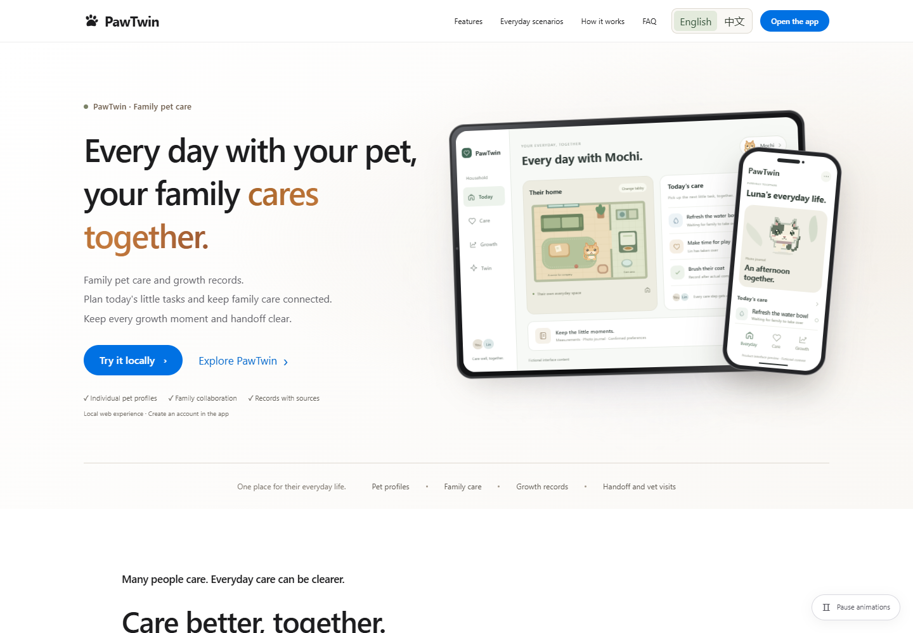

# PawTwin

**让家庭照护相互衔接，让宠物记录保留依据。**

[English](README.md) · [简体中文](README.zh-CN.md) · [功能指南](docs/FEATURES.md) · [英文评审操作指南](docs/submission/2026-10-15/judge-guide.en.md)

[](https://github.com/xf2214/PawTwin/actions/workflows/ci.yml)
[](LICENSE)

PawTwin 将宠物档案、家庭照护任务、观察、确认偏好与成长记录放在同一工作空间。家庭成员可以查看记录依据，在 Alexa 风格的网页模拟器中准备照护方案，明确确认后创建人工任务，再由另一位成员记录完成。



*已录制的界面预览；宣传页中的宠物、数据和设备画面均为虚构示例。*

> 当前版本是 **FastAPI + React + SQLite 本地原型**。家庭问答使用本地规则，Alexa 与设备交互为模拟。真实 AWS 推理、AgentCore 长期记忆、Alexa 硬件和生产部署尚未验证。

## 已有能力

- 家庭协作：本地账号、家庭邀请与角色、多宠物档案、照护计划和完成记录。
- 有依据的上下文：观察与经用户确认的偏好，由家庭应用和文字版 Alexa 模拟器共用。
- 明确确认：先准备照护方案，用户确认后才创建人工任务。
- 成长记录：实测体重、带来源的日/周报告、缺失数据提示。
- 照护交接：限时、可撤销、单宠物只读访问，以及可打印和离线导出的就诊信息卡。
- 产品体验：独立宣传页、默认英语/可切换中文、像素小屋与预设宠物管家演示。

原工作台保留虚构宠物 Mochi 的审批、硬限额、幂等和模拟设备回执流程。人工完成记录表示用户提交了记录，不能独立证明实际照护已经发生。

## 快速运行

先安装 **Git、Python 3.12、uv、Node.js 24（含 npm）和 PowerShell 7**。本地运行不需要 AWS 账号、Docker 或 AWS CLI。

```powershell
git clone https://github.com/xf2214/PawTwin.git
cd PawTwin
./scripts/setup.ps1
./scripts/verify.ps1
./scripts/dev-home.ps1 -Port 8000 -DatabasePath ./data/local-demo.db
```

打开 **http://127.0.0.1:8000/#app/home**，注册本地账号（密码至少 12 字符），创建或加入家庭。首次访问默认英语，可通过页头 **English / 中文** 切换；用户填写的内容保留原文。

启动脚本明确使用本地规则与模拟服务。资料保存在指定数据库及其相邻的 `<DatabasePath>.family.db` 中；会话保存在进程内，服务重启后需重新登录。其他启动方式未指定数据库时可能使用内存库。

| 地址 | 用途 |
| --- | --- |
| `http://127.0.0.1:8000/` | 产品宣传页，使用虚构示例 |
| `http://127.0.0.1:8000/#app/home` | 实际家庭应用 |
| `http://127.0.0.1:8000/#alexa` | 文字请求 Alexa 网页模拟器 |
| `http://127.0.0.1:8000/#workbench` | 原审批与设备模拟工作台 |
| `http://127.0.0.1:8000/#workbench/concierge` | 预设宠物管家演示 |

工作台的本地默认演示口令是 **`local-demo-passphrase`**，在工作台登录页输入即可。如果设置了环境变量 `PAWTWIN_DEMO_PASSPHRASE`，则使用该变量的值；替换口令应私下保存。详见[配置源码](backend/pawtwin/config.py)。家庭账号注册是独立流程。以上地址需要本机服务运行，仓库目前未提供托管应用或公开视频地址。

开发时可分别运行 `./scripts/dev-backend.ps1` 与 `./scripts/dev-frontend.ps1`：后端使用 `8000`，前端 `5173` 将 `/api` 代理至后端。配置见 [.env.example](.env.example)，真实 `.env` 不应入库；Windows 可用 `PAWTWIN_NODE_DIR` 指定兼容的 Node 目录。

## 验证

```powershell
./scripts/verify.ps1
uv lock --check
$env:PAWTWIN_E2E_PORT = '8001' # 使用空闲端口
./scripts/test-e2e.ps1 -InstallBrowser
```

基线验证涵盖后端、Ruff、生成契约、类型和生产构建。浏览器测试先构建，再通过四个独立服务分片执行；浏览器已安装时省略 `-InstallBrowser`，也可用 `PAWTWIN_BROWSER_EXECUTABLE` 指定现有 Chromium。默认测试排除真实计费 AWS 检查。

GitHub Actions 在 Ubuntu 和 Windows 上执行基线及浏览器回归；单独的 ECR 工作流为手动触发，需另行授权配置 AWS。普通代码推送不会部署应用。

## 代码与文档

| 目录 | 内容 |
| --- | --- |
| [backend/pawtwin/](backend/pawtwin/) | FastAPI、家庭存储、策略、工作流和可选适配器 |
| [frontend/](frontend/) | React/TypeScript 界面、宣传页和 Playwright 测试 |
| [contracts/](contracts/) | 自动生成的 OpenAPI 与领域契约 |
| [tests/](tests/) | 后端、权限、隔离与恢复测试 |
| [scripts/](scripts/) | 安装、启动、验证、导出和可选云工具 |
| [infra/](infra/) | 可选部署配置与计划 |
| [docs/](docs/) | 使用指南、状态、历史证据和参赛准备材料 |

- [功能与使用指南](docs/FEATURES.md) · [实现状态](docs/STATUS.md) · [任务看板](docs/TASKBOARD.md)
- [英文评审指南](docs/submission/2026-10-15/judge-guide.en.md) · [仓库发布说明](docs/REPOSITORY.md)
- [贡献说明](CONTRIBUTING.md) · [安全反馈](SECURITY.md) · [Agent 协作约定](AGENTS.md)
- [原 README 开发记录](README.history.zh-CN.md)：原文保留，其中日期、测试数、本机端口和“尚未发布”等语句描述对应历史时点。

历史材料中的部分 MP4、ZIP 和 Word 文件保留在仓库外，不是运行依赖。源码上传不代表公开视频或正式比赛提交已经完成。

## 能力边界与许可

本地确认偏好是数据库记录，不能称为已验证的 AgentCore 提炼记忆。云适配器和离线测试不能证明真实云连通；家庭云数据层尚未接通。Alexa 对话只保留在页面内，宠物管家回复和活动轨迹均为预设演示。传感器、执行器和 PawLink 可穿戴设备为模拟或概念；报告和就诊卡只整理已记录信息，不提供临床诊断或动物语言翻译。

采用 [MIT 许可证](LICENSE)，© 2026 xf2214；第三方依赖保留各自许可证。
