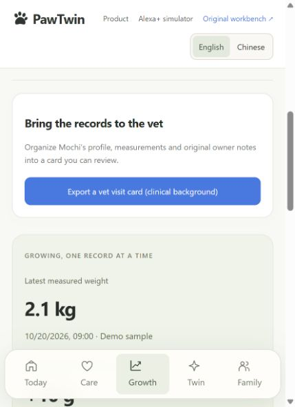

# Current App and workbench usage samples — 2026-10-20

DEMO-02, local-only. The user requested fuller, realistic usage data in the current
App and Care Workbench. These are **fictional demonstration records**, written
through existing authenticated and CSRF-protected APIs, not real pet measurements
or evidence that physical care occurred. New authored content is English.

For a fresh GitHub checkout, use the [portable demo importer](../DEMO.md).
The dated fixture below preserves this installation's historical reproduction;
its fixed day, external backup and server-specific journal are not a new-install
setup command.

## View the result

- Household App: `http://127.0.0.1:8000/?preview=20261020#app`
- Workbench history: `http://127.0.0.1:8000/?preview=20261020#workbench/history`
- Use the existing local demo sign-in and switch between the two entries. This
  populates only the existing `legacy-demo` / `demo-owner` preview household.
  Independent account households and older previews are unchanged.

## Saved records

| Area | Result |
| --- | --- |
| Profiles | Mochi, a fictional domestic shorthair kitten; Miso, a fictional corgi |
| Home items | Original four Mochi items retained; three Miso items added |
| Growth | Seven labeled weight samples per pet across October 6–20 |
| Diet | Offered / actual intake / remaining as three distinct demo samples per pet |
| Care | 13 plans, five manual demo completions, two claimed tasks; pending, overdue and recurring examples |
| Diaries / observations | Six diaries and four observations |
| Preferences | Six explicitly confirmed database preferences and two candidates to review |
| Reports | Eight current daily/weekly reports computed by the shipped backend |
| Workbench | Six runs covering approved food, recent-feeding block, missing facts, owner decline, simulated device failure and approved play |
| Feedback | Three visible English notes explaining the fictional workbench session |

Manual completions use the server's actual completion times. Only measurement
timestamps and diary event dates represent fictional past days. The current
calendar week begins October 19; the previous week begins October 12. Older
reports correctly contain no invented historical care completions. The automatic
worker retains superseded report versions (146 total, eight current); the UI
shows current reports.

The successful simulated food receipt accounts for 15 g. Failed food adds zero;
play uses zero. Current injected demonstration facts are 360 minutes / 15 g,
with unchanged 30 g daily, 15 g serving and 120-minute interval limits. There
are no unknown food receipts, unresolved feeding reservations, pending approvals
or live hardware actions. Workbench play receipts do not create App care tasks.

## Preservation and verification

Before writing, both current preview SQLite databases were backed up online to
`outputs/PawTwin-before-usage-demo-2026-10-20` outside this repository. Both backup
hashes match the manifest; backup and current databases pass integrity checks.
Original pet/item IDs and records remain present; the untouched starter Mochi
profile was completed, preserving its identity and photo field. Existing source
changes from the English UI audit remain in place.

- Independent read-only review recomputed all eight current reports at each
  saved generation timestamp: every field matched, and every cited source
  belongs to the correct pet.
- Each pet's context includes three confirmed preferences, excludes its
  candidate, and has no unresolved preference conflicts.
- A final same-day replay changed no record IDs, report count, home revision or
  workbench facts. An isolated interrupted-approval check reused the saved run
  with zero facts mutations and zero real business writes.
- Actual browser sign-in, switching between App/workbench, today overview,
  growth curve, report counts, pet switch and refresh were inspected.
- Ruff and `git diff --check` pass. No application code, API, dependency or
  generated contract changed in this task; the earlier full regression results
  belong to the English UI audit and were not rerun for this data-only update.

The [same-day fixture](demo-usage-2026-10-20/populate.py) is limited to localhost
8000, the named demo administrator, SQLite, local rules and simulated devices. It
requires verified backups and refuses to change facts when unrelated workbench
runs exist. Its deterministic event IDs and journal prevent completed replay
duplication. An interrupted pending approval resumes without changing its facts
version; expired or externally changed proposals require manual review.

Evidence: [counts](demo-usage-2026-10-20/verification.json),
[idempotent replay](demo-usage-2026-10-20/replay.json),
[approval resume check](demo-usage-2026-10-20/resume-check.json),
[saved data](demo-usage-2026-10-20/after.json), and
[scenario mapping](demo-usage-2026-10-20/workbench.json).

The existing two persistent files remain `data/workbench-preview-2026-10-20.db`
and its `.family.db` companion. The local service must stay running to use the
preview. Cookies and CSRF tokens remain in memory and are absent from evidence.
No cloud service, model, real device, publication, commit or push was performed.

