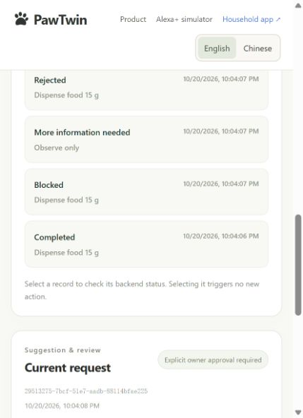

# GitHub update verification — 2026-10-21

The user requested a careful review followed by updating the existing
`xf2214/PawTwin` repository. This update integrates the English-interface audit,
the fictional usage samples and their portable setup, while preserving the local
`chore/bootstrap` branch and existing preview databases. Starting commit:
`5c6a56cdbcf37031c609914be23a28e43a9e2d3b`.

## Review findings resolved

- Default demonstration names, objects, localized forms and generated care
  titles follow the selected language. Authored records and dirty form drafts
  keep their original wording.
- Care replies now carry a small, scoped source snapshot. App, Alexa-style
  display/speech, care citations and read-only replies translate a missing-title
  fallback only when its source flag is true. Identical owner-authored titles
  remain literal; editing a task or pet does not rewrite an earlier care reply.
  Model-generated replies clear unrelated local-care presentation metadata.
- The dated sample fixture remains historical evidence. A new explicit
  [portable importer](../../scripts/seed_demo.py) creates the populated experience
  on another household day and a fresh local instance. The bilingual README and
  [walkthrough](../DEMO.md) document the actual commands and boundaries.
- The importer saves deterministic event intent before submission. Interruption
  before submission, after server acceptance and during the subsequent
  checkpoint can resume without duplicating runs or reinjecting approval facts.
  Existing records, unrelated runs, changed facts/device mode and foreign journals
  cause refusal. Windows journal replacement retries are bounded and atomic.
- New account/provenance browser cases exceeded the existing registration limit
  in a four-shard run (HTTP 429). The runner now uses five isolated services;
  production limits remain unchanged and retries stay disabled.

Independent reviewers inspected frontend behavior, backend provenance/privacy,
stored report arithmetic, publication files and importer recovery. Confirmed
findings were reproduced before fixes and re-reviewed after changes; no material
finding remains open.

## Final local verification

| Check | Result |
| --- | --- |
| Complete backend suite | 539 passed, 1 skipped, 21 live-AWS tests deselected; 161.70 s |
| Complete browser suite | 129 passed: 26 + 28 + 25 + 37 + 13; zero retries |
| Python lint | Passed |
| Generated contracts | Current |
| Dependency lock | Current |
| TypeScript and production build | Passed |
| Diff whitespace | Passed |
| Fresh HTTP demo import and completed replay | Passed on isolated port 8861, household day 2026-10-21 |
| Existing preview after backend restart | Non-report household document content unchanged |

The real HTTP smoke created two fictional profiles, 20 demo measurements,
13 plans, five server-timestamped manual demo completions, eight current reports
and six workbench runs. Replaying returned the same result. Tests cover both
inline and background analysis plus refusal and recovery cases. The separate
smoke service was stopped; its database and journal remain ignored local files.

The existing Starlette/AnyIO deprecation and the existing frontend chunk-size
warning remain. No live AWS, model, Alexa platform, hardware or production
deployment was exercised. Workbench receipts and measurement samples remain
explicitly simulated/fictional.

## Preservation and publication

Before integration, 48 changed/new files and both persistent preview databases
were copied/backed up outside Git in
`outputs/PawTwin-before-github-update-2026-10-20`. Original work and older previews
were not discarded. Report-worker updates after midnight are new derived
versions; they do not replace the saved historical evidence.

Candidate-file review found no actual database, private environment file,
credential/session JSON, cookies or browser traces. The documented default local
passphrase was already public and explicitly approved by the user. New JSON
evidence contains only fictional demo identities and records.

The local checks above were completed before committing. The authorized target
is the existing `origin/main`, using a normal fast-forward push. The resulting
commit and post-push workflow status are available in
[repository history](https://github.com/xf2214/PawTwin/commits/main/) and
[GitHub Actions](https://github.com/xf2214/PawTwin/actions). Publication provides
source and reproducible local examples, not a hosted service or competition
submission.

