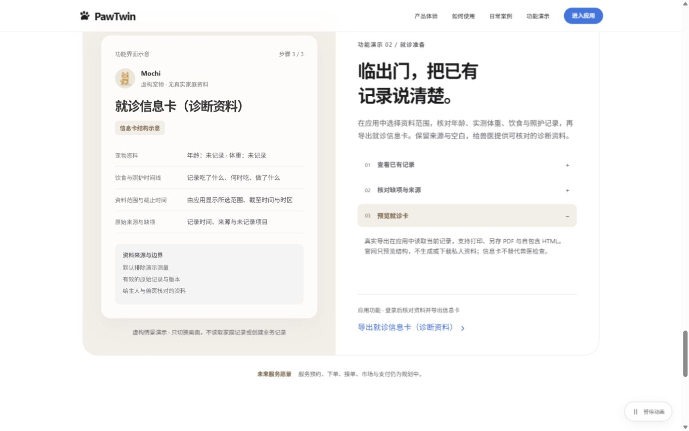
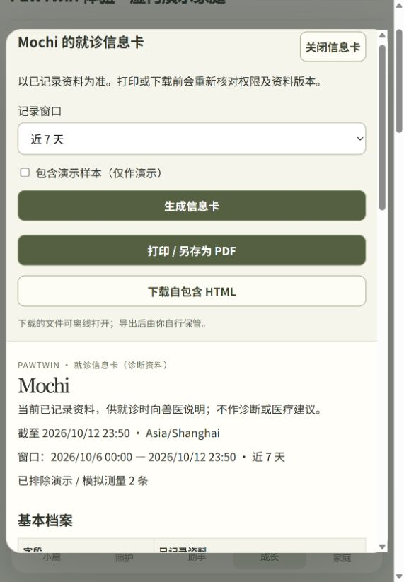

# PawTwin 照护交接与就诊卡验收（2026-10-12—13）

状态：done_local。12 日启动，13 日完成本地集成、浏览器与独立复核。

## 需求与实现边界

用户批准原产品方案后，将本轮实际功能限定为：导出就诊信息卡、管理员创建指定宠物/有效期/可撤销的分身只读入口，以及官网案例与功能演示。照护服务的实际预约、接单、市场、支付和售后仍为规划。本轮不调用云端，不修改原数据库/媒体，不提交、推送或发布。

[细化产品方案](../plans/PawTwin_照护平台与就诊信息卡_2026-10-12.md)和[TASKBOARD](../TASKBOARD.md)记录所有权与裁定。当前 dirty 工作区是基线，非 HEAD-only；修改前文件保存在 [before](../../../PawTwin-before-platform-2026-10-12)，[baseline](platform-2026-10-12/baseline.json)保存 SHA256。源码备份移出仓库，避免被检查误认作现行源码；原内容未改写。设备六输入领域契约保持原样；新增 API 的 OpenAPI 从代码生成。

## 回归证据

- 后端全量：`uv run --frozen pytest -rs` → **425 passed / 1 skipped / 21 live AWS deselected，53.60 秒**；[完整输出](platform-2026-10-12/backend-final.log)。跳过项为 `tests/test_restart_subprocess.py:128` 的 best-effort Uvicorn kill/relaunch；其他逻辑/子进程恢复测试运行。既有 Starlette/AnyIO 弃用警告不属于本轮变更。
- 静态与契约：`uv run --frozen ruff check .`、`uv run --frozen python scripts/export_contracts.py --check`、`git diff --check` 通过。新增四条 URL 的契约冻结曾观察到 2 项预期失败，再由 Python 源模型生成 OpenAPI；设备领域契约未改。
- 前端：`npm run typecheck`、`npm run build` 通过。最终 JS 为 `index-Y9lFXRv6.js`（396.75 kB），CSS 为 `index-CZyIKk42.css`（71.15 kB）；未增加依赖或改锁文件。
- 浏览器最终 **77 passed、0 retries，覆盖全部 13 个 spec 文件**：8830 的 48 项既有/官网（1.2 分钟，[输出](platform-2026-10-12/final-existing.log)）；8831 的 17 项实用性（39.1 秒，[输出](platform-2026-10-12/final-usability.log)）；8832 的 12 项本轮功能（30.0 秒，[输出](platform-2026-10-12/final-platform.log)）。各组使用独立全新服务和内存测试库。

运行前设置 `PAWTWIN_BROWSER_EXECUTABLE=C:/Program Files/Google/Chrome/Application/chrome.exe`，并用项目 `scripts/node-runtime.ps1` 定位 Node。首次全量尝试发现 Playwright 默认 headless shell 缺失，改用已有 Chrome 复验，不安装新浏览器、不改断言。最初合并 platform/usability 的第29项触发既有真实注册限流；拆分服务后17项全通过，未放宽限流。官网动画测试两处 locator 缺步骤编号，修正语义 group 和编号后全部48项通过，产品动画代码不变。

新增 API 最初 12 项因缺少能力按预期失败，补强后17项新增+家庭/统计定向65项通过。两个只读快捷问法原先错误落到待办，修为饮食/实际完成事实专项读取；500禁缓存曾以注入异常观察到缺 header 后修正。前端导出/授权2项和官网3项先在旧 dist 上观察到预期缺失，再做绿色验证。

独立复核已提出“归档→恢复导致旧授权复活”的生命周期问题，已增加回归并以持久撤销处理；授权管理员降级/移除后重新获得权限，也不恢复原授权。复核者独立内存复现 token 哈希/安全投影/只读无副作用、生命周期及正确饮食/照护引用；最终 **0 个开放发现**。家庭 guest 仍执行原有 POST 拒绝政策，资料概览诚实显示失败未知态；外部真实只读提问使用新授权入口。

## 实际预览与下载

最终 [功能演示](http://127.0.0.1:8820/#vision)、[成长页导出](http://127.0.0.1:8820/#app/growth)、[家庭页临时授权](http://127.0.0.1:8820/#app/family)。预览使用 `data/platform-preview-2026-10-12.db` 及其 `.family.db`，由原虚构演示库只读 SQLite backup 生成；旧库未覆盖。8820 为唯一使用该副本的预览实例，临时8826已关闭。

内置浏览器真实生成卡片、默认排除2条窗口内演示测量、保留人工完成事实，并下载了自包含 HTML。[下载后的示例文件](platform-2026-10-12/preview-visit-card.html)仅含虚构演示家庭资料；检查 UTF-8、无脚本/远程资源/访问密钥、真实字段结构与缺项。HTML源内容经过安全转义；打印媒体样式在浏览器回归检查通过。未将虚构样本标为真实健康资料。

内置浏览器实际创建1小时授权→以独立只读入口查看宠物与已完成照护→询问分身→主人撤销→再次进入显示失效并清空资料；演示授权已撤销。1440/390 实际官网检查无横向溢出，临时viewport已重置。自动回归另覆盖320/390/1440、复制回退、迟到切宠/切密钥、503重试、删除/版本改变/成员撤权阻止导出、全局暂停/减少动画与官网零业务请求。

## 数据与访问说明

就诊卡整理当前已保存资料，保留估计年龄、实测来源、原饮食备注、完成事实和历史观察；不补造食物、摄入、症状或诊断。默认排除演示测量；可由主人明确选择纳入并保留演示来源。窗口外最近一次有效体重保留其原日期。历史“仅今天”观察在就诊历史窗口可回看，分身当前建议仍使用有效上下文。

临时访问不授予家庭成员、写记录、确认任务或设备权限；只显示该宠物档案/确认偏好/近7天观察、照护、测量及近期待办，不显示账号/家庭ID、照片、私人日记、其他宠物或历史修订。密钥只在创建时返回，存储哈希；访客通过 Authorization header 查询，前端仅内存使用，不持久保存密钥。接口响应禁止缓存。

HTML 导出是独立的静态文件；浏览器打印可另存 PDF。已下载或打印的文件不会随之后的资料变化更新。真实家庭数据不得被官网示例读取，预览为虚构界面结构。

## 尚未建立的证据

真实外部照护运营、跨设备部署、真实家庭/兽医试用、医疗诊断、真实 Alexa+ 接入、新云调用和服务交易均未执行。本轮代码与本机浏览器验证只能证明所述本地功能。
