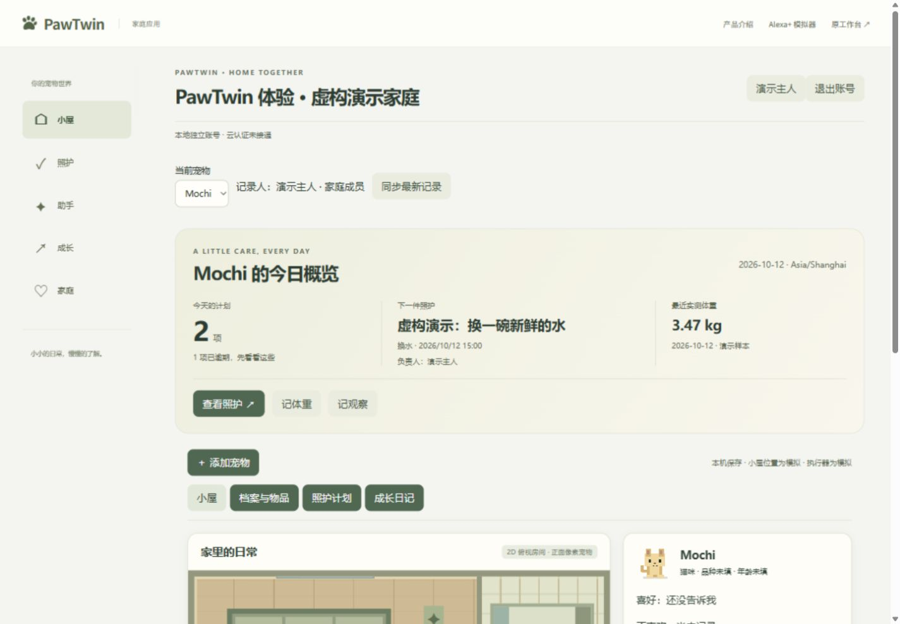
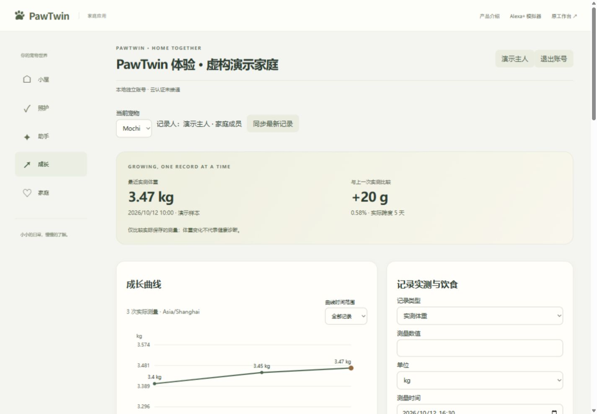

# PawTwin 实用性与可视化验收

2026 年 10 月 12 日，用户确认先完善实际应用，再同步官网。此次沿用当前业务接口，完成日常照护、成长记录和展示的改进。源码仍在原 `chore/bootstrap` 未提交工作区，既有家庭功能、云适配与媒体保留。

## 交付内容

| 模块 | 最终行为 |
|---|---|
| 功能梳理 | [功能与使用指南](../FEATURES.md)整理入口、家庭能力、日常流程和真实/模拟边界 |
| 今日概览 | 家庭时区下的全天计划、逾期数量、下一件照护/负责人、最近有来源的体重；直达照护、体重和观察 |
| 照护队列 | 全部/今天/逾期/我负责/已完成筛选，待办优先；重复任务的完成历史与下次计划分别显示 |
| 快捷与编辑 | 标题编辑保留原时间、秒数和周期；类型切换保留时间/周期/负责人；物品关联照护保留陪玩/换水/清洁意图 |
| 成长可视化 | 最近测量和实际比较跨度，全部/30/90 天实测曲线、纵轴、点详情、可访问数据表；同一时刻不同偏移不计算变化 |
| 读取与权限 | 成长/报告/记忆独立读取和重试，慢响应切宠隔离；401/403 清除缓存或遮蔽家庭视图 |
| 报告 | 可扫描统计卡与可读来源/版本；持久化完成事实不会随活动历史 1000 条截断而丢失 |
| 官网与路由 | 对应功能深链、独立 Alexa 网页模拟入口、与实际流程一致的示意；保留虚构标签和零公开业务请求 |

界面保留俯视房间与正常正面像素宠物。未知/未记录值不填零，不新增健康、饥饿或心情评分；人工照护与模拟设备结果分开。

## 修复证据

后端新增 15 项回归，先观察错误，再验证修复：1001 条无关活动后的旧报告、旧日志与持久化事实去重、改名重复任务、迁移后缺少更新时间的旧修订、未知作者归属、家庭/宠物/删除/取消/未来事实隔离、午夜边界与来源关联。

Windows 同一时钟刻度曾使已保存回执时间等于报告截止时间，导致成功结果漏算。已增加回执、人工完成和测量的同刻度回归：当前不完整窗口包含截止时刻已保存的事实，闭合日/周窗口结束仍为排他边界。此前新测试对当前截止时刻作半开区间的假设已按这一明确规则更正，严格未来事实和闭合窗口边界仍验证排除。

前端新增 17 项行为检查，包含深链登录/刷新/返回、重复编辑与完成历史、家庭时区、独立重试、迟到响应、密集等值测量、同一时刻不同偏移、物品关联类型、撤权、延迟观察聚焦、类型切换保留表单，以及 320/390/1440 布局和键盘。原双账号照护、审批、拒绝、回执、反馈与 Alexa 体验保留。

独立只读复核比较完整工作区快照，而非较旧 HEAD。发现的迁移重复计数、未知作者、同一时刻比较、关联类型、表单重建、异步聚焦均已修复并复核。最终没有本轮剩余可操作发现。

## 最终验证

| 检查 | 结果 | 证据 |
|---|---|---|
| 后端全量 | 408 passed / 1 skipped / 21 deselected，40.15 秒 | [final-backend.log](usability-2026-10-12/final-backend.log) |
| Ruff | PASS | [final-ruff.log](usability-2026-10-12/final-ruff.log) |
| 生成契约 | current，无生成文件/依赖修改 | [final-contracts.log](usability-2026-10-12/final-contracts.log) |
| TypeScript / build | PASS | [类型](usability-2026-10-12/final-typecheck.log)、[构建](usability-2026-10-12/final-build.log) |
| 既有流程与官网 | 45 passed，1.1 分钟，0 retries | [final-existing-browser.log](usability-2026-10-12/final-existing-browser.log) |
| 新实用性流程 | 17 passed，43.5 秒，0 retries | [final-usability-browser.log](usability-2026-10-12/final-usability-browser.log) |
| Alexa 往返竞态 | 原完整流程连续 3 次通过 | [app-route-regression.log](usability-2026-10-12/app-route-regression.log) |

浏览器合计覆盖全部 12 个测试文件、62 项检查。45 与 17 分别使用 8824/8825 全新服务、独立内存库和结果目录；保留每个服务单 worker 和 0 retries。早期组合 37 项的 7 个失败保留在 [app-final.log](usability-2026-10-12/app-final.log)：5 个达到注册限流，1 个后来修复的 Alexa→助手路由竞态，1 个旧导航断言。最终通过分批隔离保留生产限流，导航断言改为准确目标并验证“个人设置”可见。

后端跳过项为具名的尽力型运行中 Uvicorn 强杀/重启检查；其他重启逻辑和子进程测试仍运行。21 项真实 AWS 检查按既定标记排除。既有 Starlette/AnyIO 弃用警告和浏览器颜色环境警告保留，未升级依赖。

## 预览与画面

本机[新版应用](http://127.0.0.1:8820/#app/home)、[成长](http://127.0.0.1:8820/#app/growth)、[官网](http://127.0.0.1:8820/)。使用独立 `data/usability-preview-2026-10-12.db`，内置浏览器登录虚构演示家庭。三次体重均标注为演示样本，照护标题标注“虚构演示”。实际走通保存测量、曲线与周报，人工计划、领取、完成、筛选与报告回写。

宽度 320/390/1440 的最终全页截图在 `usability-2026-10-12/final-usability-results`，覆盖小屋、照护与成长。预览是本机应用；正式用户试用、AWS/真实模型/真实 Alexa/硬件验证仍单独进行。

## 基线与限制

初始全量为 393 passed / 1 skipped / 21 deselected，见[基线日志](usability-2026-10-12/baseline-verify.log)。原工作区 SHA/状态在 [baseline.json](usability-2026-10-12/baseline.json)。变更前代码和入口快照为工作文件夹 `outputs/PawTwin-before-usability-2026-10-12.zip`，校验值在 [backup-hashes.json](usability-2026-10-12/backup-hashes.json)。

最终逐一核对 103 个基线文件，本轮修改的 15 个既有文件均在认领范围，其他基线文件没有变化；本轮初次链接检查的 62 个本地链接全部有效。结果保存为 [preservation-and-links.json](usability-2026-10-12/preservation-and-links.json)。`git diff --check` 通过，HEAD 保持 `31da349`。

新完成事件有精确 occurrence/task 关联。旧日志没有关联时，仅以同宠物、成员、历史任务标题和一秒时间范围做一对一兼容匹配，保留原始来源；已经丢失且没有持久化完成事实的记录不能重建。重复周期仍是整数天间隔，完成后按实际完成时间计算下一次；没有新增固定钟点调度或外部通知。

原用户库、照片和媒体未参与此轮预览或被覆盖；锁与生成契约没有本轮修改。没有 AWS 调用、资源、费用、推送、上传、发布或提交。
